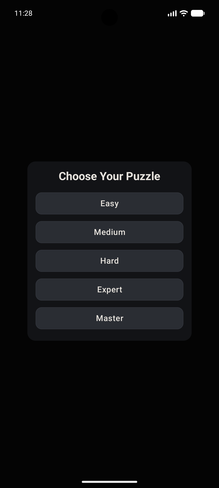
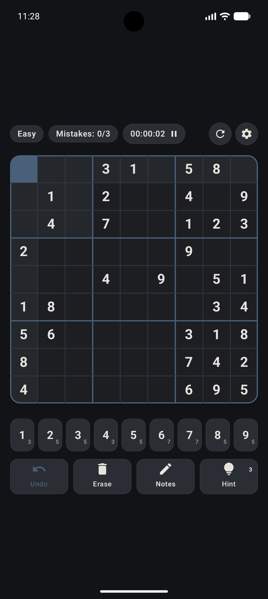
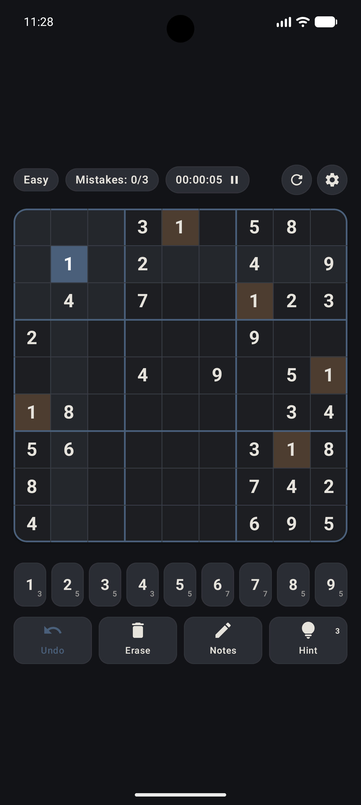
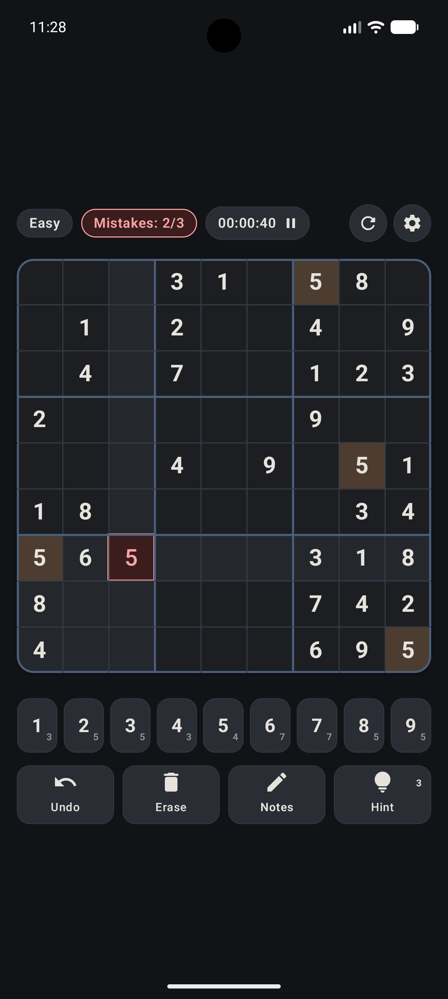
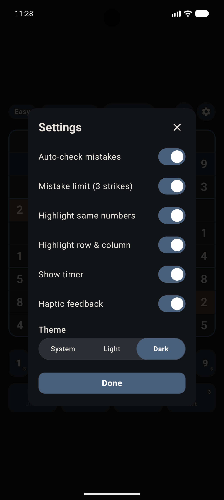
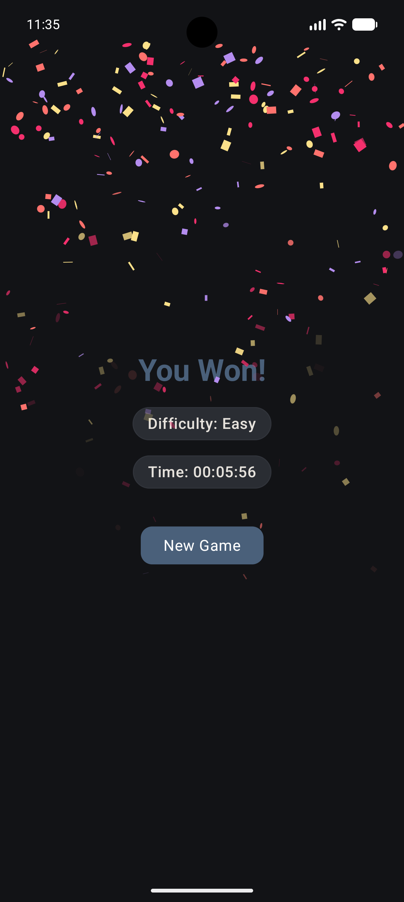

# Sudoku

This game is written in Kotlin using Jetpack Compose with Material 3. DataStore is used to persist settings and theme choices (System, Light, or Dark).

It features an editorial, paper-like warm aesthetic, adaptive edge-to-edge support, predictive back gestures, tactile keypad controls, and portrait / landscape layouts optimized for mobile devices.

---

## 📸 Screenshots

### Puzzle Level Selection

Choose your puzzle difficulty (Easy, Medium, Hard, Expert).

### Grid View & Cell Interaction
| Grid Overview | Cell Selected & Highlights |
| :---: | :---: |
|  |  |

- **Warm Editorial Surface**: Pure white 9x9 board on alabaster paper background with crisp hairline cell dividers and rounded outer container.
- **Given vs User Numbers**: Pre-filled numbers are rendered in bold near-black text (`FontWeight.Bold`), while user-entered numbers appear in a distinct slate blue (`FontWeight.Medium`).
- **Tactile Keypad & Action Dock**: Digits 1–9 presented as tall cards with remaining counts. Action toolbar provides Undo, Erase, Notes (with an active "ON" pill indicator), and Hints.

### Error Checking & Feedback

When auto-check mistakes is enabled, wrong entries are highlighted in a soft coral background with crimson text and a 2.dp stroke overlay when selected.

### Settings & Real-Time Customization

Modern reactive settings dialog with instant real-time updates:
- **Auto-check mistakes**: Main toggle for error validation.
- **Mistake limit (3 strikes)**: Dependent sub-toggle for 3-strike game over mode.
- **Highlight same numbers**: Highlights matching digits across the grid.
- **Highlight row & column**: Soft warm gray highlight for row, column, and 3x3 box.
- **Show timer**: Toggles the top timer pill badge.
- **Haptic feedback**: Tactile vibration feedback on input.
- **Theme**: 3-Way Segmented Control ("System", "Light", "Dark").

### Victory & Celebration

Celebrates puzzle completion with [Konfetti](https://github.com/DanielMartinus/Konfetti) particle animations and game summary pill badges.

---

## 🚀 Planned Features & Vision

### Phase 1: Store Readiness & Analytics (MVP Release)
- [ ] **Persistent Statistics & Analytics**: Track win rates, best completion times, average solve times, and games played using DataStore/Room.
- [ ] **Material You Dynamic Color**: Support dynamic system theming on Android 12+ (Monet engine).
- [ ] **Google Play Store Assets & Optimization**: App store listing descriptions, feature graphics, localized metadata, and privacy disclosures ("100% Ad-Free, No Tracking").

### Phase 2: Engagement & Retention
- [ ] **Daily Challenges & Streak Tracking**: Daily puzzle calendar system with streak badges and reward celebrations to boost daily active users.
- [ ] **Adaptive UI for Tablets & Foldables**: Dual-pane Compose layout for larger screens (tablets, foldables, Chromebooks) utilizing Material 3 Adaptive Layouts.
- [ ] **Google Play Games Integration**: Achievements (e.g. "First Win", "Master Solver", "7-Day Streak") and optional leaderboards.
- [ ] **Home Screen Widget**: Glance widget for quick access to the Daily Challenge.

### Phase 3: Smart Features & Advanced AI
- [ ] **Explanatory "Technique-Based" Hints**: Replace random cell revelations with interactive logical explanations (e.g., Naked Singles, Hidden Pairs, X-Wing) to serve as a Sudoku tutor.
- [ ] **Camera / Paper Sudoku Scanner**: Offline OCR scanner using CameraX and ML Kit Text Recognition to scan and solve physical newspaper/book Sudoku puzzles.
- [ ] **Additional Puzzle Variants**: Support for mini 6x6 grids, Killer Sudoku, or custom seed generators.

---

## 📄 License & Copyright

Copyright © 2025-2026 Natalia Usoltseva. All rights reserved.

This project is open source and available under the [MIT License](LICENSE).
